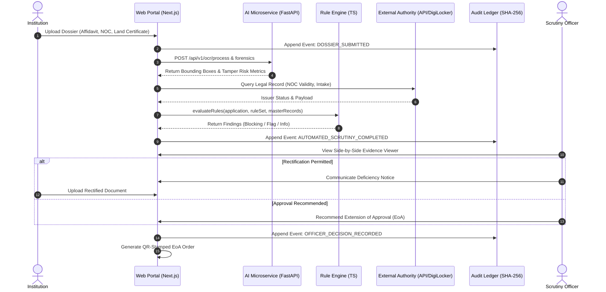

# NirikshAI Regulatory Data Flow

This document details the lifecycle of an application from submission to regulatory order generation.

## Security & Data Integrity Controls
- **Client-Side SHA-256 Hashing**: Document fingerprints computed before network transport.
- **Envelope Encryption**: Sensitive institutional records encrypted at rest using AES-256-GCM.
- **Fail-Safe Circuit Breaker**: If issuing authority remote APIs time out beyond 3 retries, the state machine resolves to `manual_review_required` without halting administrative processing.
