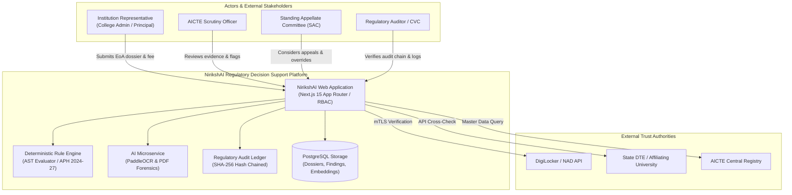

# NirikshAI Architecture Overview

NirikshAI is an AI-powered regulatory decision-support system designed to integrate seamlessly into the AICTE (All India Council for Technical Education) web portal for processing Extension of Approval (EoA) and institutional approval changes under the statutory mandate of the AICTE Approval Process Handbook (APH 2024-27).

## C4 Context Diagram

## System Components

1. **Web Portal (`apps/web` / root Next.js)**:
   - 5 RBAC portals: Institution, Scrutiny Officer, Committee, Admin, Auditor.
   - Interactive evidence viewer highlighting bounding boxes on multi-page PDFs.
   - Public approval verification portal with cryptographic QR code validation.

2. **Deterministic Rule Engine (`packages/rule-engine`)**:
   - Zero hallucination AST evaluator executing codified APH legal rules.
   - 7-State Verification Automaton (`verified`, `mismatch_detected`, `expired`, `verification_pending`, `source_unavailable`, `manual_review_required`, `unsupported`).

3. **AI Microservice (`services/ai-service`)**:
   - PaddleOCR for bilingual Hindi/English text and table extraction.
   - PDF Forensics engine analyzing incremental update counts, font discrepancies, and cloned hashes.

4. **Audit Ledger (`packages/ledger`)**:
   - Cryptographic hash-chain where each regulatory action is hashed with the previous block: `SHA-256(prev_hash + canonical_json(event))`.
   - Admissible under Section 65B of the Indian Evidence Act.
